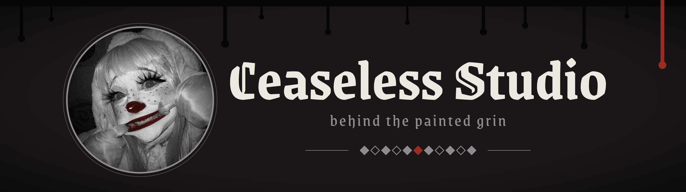

<!--
  Ceaseless Studio — GitHub profile README
  1. Create a public repo named exactly like your GitHub username.
  2. Put this file in its root as README.md and the banner at assets/banner.png.
  3. Keep only the stack badges you actually use.
-->

  

<h3 align="center">Behind the painted grin: Discord bots, automation & visual novel localization.</h3>

  
  

◆ ◇ ◆ ◇ <b>◆</b> ◇ ◆ ◇ ◆

### ◆ Who's behind the mask

- 🃏 I build **Discord bots** and the little tools that keep a server running while nobody's watching.
- 🖋 I translate and proofread **visual novels into Russian**, currently proofreading *The Last Embrace* (NoX Productions).
- 🎪 I moderate and help run **Discord communities**: roles, permissions, supporter tiers, the whole circus.
- 🕯 Everything I make lives under one name: **Ceaseless Studio**.

### ◆ The act

| Act | Role | What happens behind the curtain |
| --- | --- | --- |
| 🖋 **[The Last Embrace](https://store.steampowered.com/app/4437270/The_Last_Embrace_Book_One/)** | Proofreader (RU) | Russian proofreading for the visual novel by NoX Productions |
| 🎪 **[Driven By Desire](https://kloppstyle.itch.io/driven-by-desire)** | Discord moderator | Keeping order on the visual novel's Discord server |
| 🃏 **Ceaseless Studio** | Bot · Creator & owner | Built and run entirely by me. The backstage of a modeling agency: contracts, roles and reports, so the runway show never stops |
| 🕯 **Maria** | Bot · Creator & owner | Cease's personal assistant on the Driven By Desire Discord server |

### ◆ Tools of the trade

<!-- Delete the badges you don't use, add the ones you do. More at https://shields.io -->

  
  
  
  
  

### ◆ The ledger

  

### ◆ Tongues I speak

  
  

### ◆ Find me after the show

  

◆ the grin stays on, the work never stops ◆

